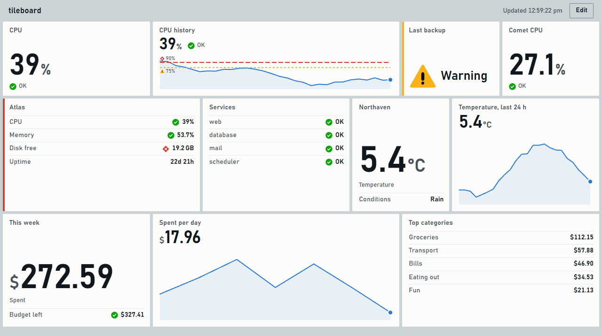
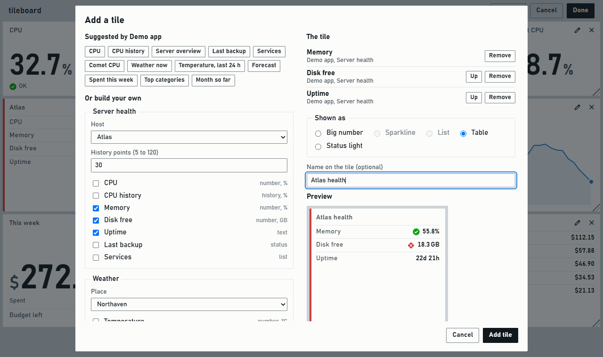
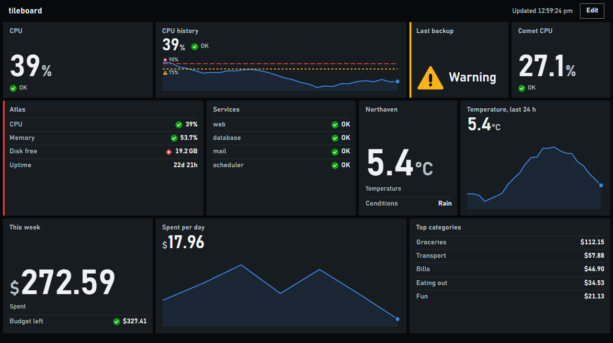
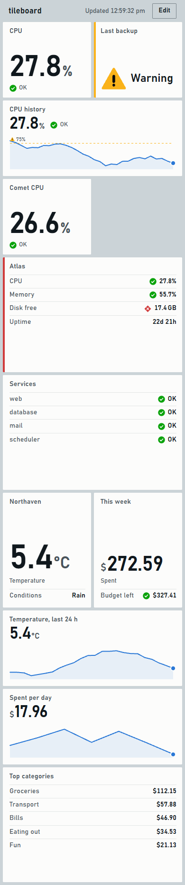

# tileboard

One page of tiles fed by all your apps: server health next to the weather next to this week's spending.

Your apps say what data they have. You tick the fields you want, and the dashboard builds the tile. Then you drag and resize tiles until the board looks right.



*Everything in these pictures is made up by the built-in demo app.*

## What is different

Most home dashboards ask you to write a template, a YAML mapping or a query for every widget.

Here an app answers **two read-only JSON addresses** that describe its data. The dashboard reads that and builds the picker itself. No template and no config per tile.

- **Any mix of data.** One value on a tile, or several. The same value on as many tiles as you like. Values from different sources, or different apps, on one tile.
- **Apps never decide the look.** They send numbers, texts, statuses, histories and lists. The dashboard draws all of it the same way.
- **The browser never talks to your apps.** The dashboard server does, so tokens stay on the server.

## Try it

You need [Rust](https://www.rust-lang.org/tools/install) (1.88 or newer). Nothing else: no Node, no database.

```sh
cargo run -- --demo
```

Open <http://127.0.0.1:4700>. The demo runs fast on purpose (one made-up hour of weather per minute) so there is something to watch. Nothing is saved.

## What you get

- **Five ways to show a value:** big number, sparkline, list, table, status light.
- **Status you can read at a glance:** a shape, a word and a colour, never colour alone. A tile with a warning carries a strip on its edge.
- **Thresholds from the app:** an app can say "warn at 75, critical at 90" (or the other way round, for things like free disk space) and the dashboard does the rest.
- **It refreshes by itself**, as often as each app says its data changes. However many tiles and browsers there are, an app is called once per refresh.
- **Honest when something is wrong:** if an app stops answering, its tiles keep their last values, dimmed, with a note saying since when. A tile that cannot be drawn says why, in words.
- **Light and dark**, following your system. A two-column layout on a phone.

### Edit mode

Choose **Edit**. Every tile can now be dragged and resized; the others make room. **Add tile** opens the picker. **Done** saves and locks the board. **Cancel** puts everything back.



With the keyboard: arrow keys move the focused tile, Shift with arrow keys resizes it, Enter changes it, Delete removes it.

 

## Show your own app

An app implements two addresses. The first says what it has:

```json
{
  "contract": 2,
  "app": "greenhouse",
  "title": "Greenhouse",
  "sources": [
    {
      "id": "air",
      "title": "Air",
      "refresh_s": 60,
      "fields": [
        { "id": "temp", "label": "Temperature", "type": "number", "unit": "°C", "warn": 30, "crit": 35 },
        { "id": "temp_day", "label": "Temperature today", "type": "series", "unit": "°C" },
        { "id": "vent", "label": "Vent", "type": "status" }
      ]
    }
  ]
}
```

That is `GET /widgets`. The second, `GET /widgets/air`, gives the values:

```json
{
  "updated_at": "2026-11-24T09:30:05Z",
  "values": {
    "temp": { "value": 24.5 },
    "temp_day": { "value": 24.5, "series": [18.2, 19.0, 21.4, 23.8, 24.5] },
    "vent": { "value": "ok" }
  }
}
```

That is the whole idea. The details (params, lists, links, errors, an optional token) are in **[SPEC.md](SPEC.md)**, with JSON Schemas in [`schema/`](schema/). The demo app in [`src/demo.rs`](src/demo.rs) is a complete example.

### Hand it to whoever writes the app

You do not have to explain any of this yourself. On the dashboard, **Settings → Connect an app** gives one address, `/connect.md`, that holds everything a developer or an AI agent needs: what to build, the full contract, how to check their work, and how to register the app. Give them that address and nothing else.

The dashboard also checks an app for them. It calls the app the way it will later, and says exactly what is wrong:

```sh
curl -s -X POST http://127.0.0.1:4700/api/check -H "Content-Type: application/json" \
  -d '{"base_url": "http://127.0.0.1:8080"}'
```

With `manage_apps = true` in `config.toml`, an app that passes can be added from the settings page (or by the agent itself, with one call) and shows up at once; it is kept in `apps.json` next to your layout. This is off by default: the dashboard has no login, so turning it on lets anyone who can open the dashboard make it call an address.

### Or write it into the config

Tell the dashboard where the app is:

```sh
cp config.example.toml config.toml   # then edit it
cargo run --release -- --config config.toml
```

```toml
listen = "127.0.0.1:4700"

[[apps]]
name = "greenhouse"
base_url = "http://127.0.0.1:8080"
```

An app that is unreachable, or whose answers do not follow the spec, is listed on the board with the reason.

### Run it as a service (Linux)

`cargo build --release` gives one binary, `target/release/tileboard`, with the page built in. A user-level systemd unit needs no root:

```ini
# ~/.config/systemd/user/tileboard.service
[Unit]
Description=tileboard
After=network-online.target

[Service]
WorkingDirectory=%h/tileboard
ExecStart=%h/tileboard/tileboard --config %h/tileboard/config.toml
Restart=on-failure
RestartSec=5

[Install]
WantedBy=default.target
```

```sh
systemctl --user enable --now tileboard
loginctl enable-linger "$USER"    # keep it running when you are logged out
```

Set `listen` in `config.toml` to an address on your private network (a VPN address, for example), not to `0.0.0.0`.

## Keep it private

- **The dashboard has no login.** Run it on a private network (your home network, a VPN). Do not put it on the open internet.
- **It only reads.** It sends `GET` requests to your apps and nothing else.
- **`http://` only, for now.** It cannot call apps over `https://` yet.
- **Tokens stay on the server.** If an app wants a token, it goes in `config.toml`; the browser never sees it.
- **What apps send is shown as plain text**, never run as HTML. The page loads nothing from other sites.

## How it is built

- **Server:** Rust, one binary, the frontend files built in. Seven direct dependencies (`axum`, `tokio`, `hyper-util`, `http-body-util`, `serde`, `serde_json`, `toml`), all pinned in `Cargo.lock`.
- **Frontend:** plain JavaScript modules and one stylesheet. No framework, no build step, no package to install.
- **Your layout** is one JSON file next to the config. Back it up by copying it.

```sh
cargo test                           # server, demo app, spec and schemas, frontend logic
cargo run -- --demo --web-dir web    # frontend changes show on reload
node tools/look.mjs                  # look at the running page in a headless browser
node tools/try-edit.mjs              # use edit mode in a headless browser (fresh --demo)
```

The frontend tests and the two tools need Node 22 or newer and an Edge or Chrome on the machine. `cargo test` skips them if Node is missing.

## Known limits

- No `https://` towards apps yet, and no login on the dashboard.
- A sparkline shows evenly spaced points with no times.
- Dragging a tile near the edge of the window does not scroll the page.

## Licence

[MIT](LICENSE).
